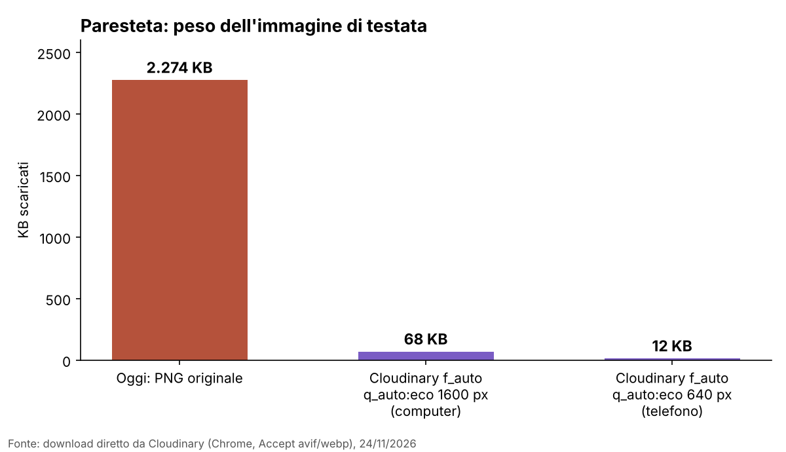
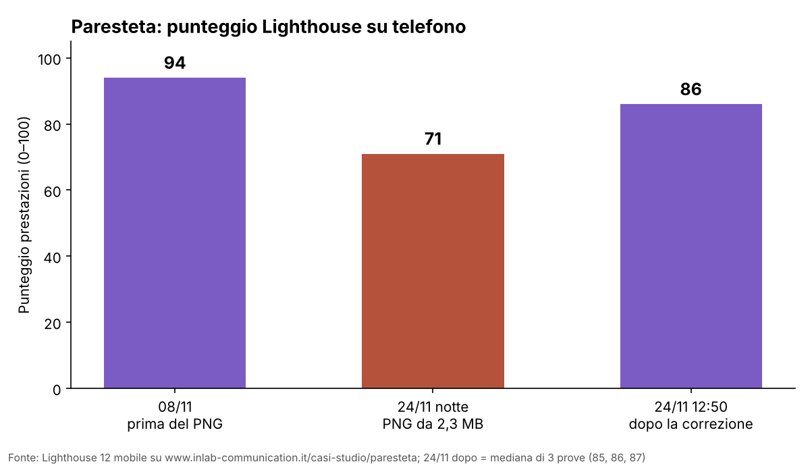

# Immagine di testata dei casi studio — 24/11/2026

Addetto performance, su segnalazione del Direttore: `/casi-studio/paresteta` era a 70 su mobile in Lighthouse.

## Misura prima (24/11, ore 00:35 UTC, main 8420653)

Lighthouse 12, una prova per dispositivo, sempre con www.

| `/casi-studio/paresteta` | Perf. | LCP (reale) | FCP | TBT | CLS | Peso pagina |
|---|---|---|---|---|---|---|
| Mobile | **71** | **15,1 s** (0,98 s) | 2,7 s | 60 ms | 0 | **2.741 KB** |
| Desktop | 82 | 3,0 s (1,0 s) | 1,0 s | 0 ms | 0 | 2.758 KB |

L'8/11 la stessa pagina era a 94 su mobile con 438 KB. Il peggioramento arriva dalla nuova immagine di testata.

- **Elemento LCP**: l'immagine di testata, `PRESENTAZIONE_PARESTETA_1_c8hm0u.png`: **PNG da 2.274 KB**.
- La pagina la scarica **senza nessuna trasformazione Cloudinary** (niente `f_auto`, `q_auto`, `w_`): stesso file su telefono e su computer.
- ~~Stesso problema su `/casi-studio/ricciardi`~~ **Correzione delle 12:50**: falso allarme. L'indirizzo senza trasformazione (JPG da 168 KB) si trovava nei dati della pagina (`#site-content`), non in un'immagine mostrata. In testata Ricciardi non ha nessuna immagine Cloudinary: ci sono solo anteprime del sito, in lazy.



## Causa: codice, non l'immagine caricata

- `src/pages/CaseStudyPages.tsx:473`: `<motion.img src={heroImage} …>` usa l'indirizzo originale.
- Le altre immagini della stessa pagina passano già da `cld()`: per esempio riga 127, con `srcSet` 800/1200/1600. Anche l'immagine di testata delle schede cliente in `App.tsx` passa da `cld()`, con `srcset` e `q_auto:eco`.
- Per questo la soluzione proposta dal Direttore (Nicola ricarica l'immagine come JPG/WebP) aiuterebbe solo questa pagina, e solo in parte. Ogni immagine caricata in futuro come testata avrebbe lo stesso problema. La correzione nel codice risolve tutte le pagine e non chiede niente a Nicola.

## Richieste per lo sviluppo

1. **Alta · Immagine di testata dei casi studio attraverso Cloudinary.**
   - File: `src/pages/CaseStudyPages.tsx:473`.
   - Soluzione, come nell'immagine in alto delle schede cliente:
     ```tsx
     src={cld(heroImage, 1600)}
     srcSet={[640, 960, 1280, 1600].map(w => `${cld(heroImage, w)} ${w}w`).join(', ')}
     sizes="100vw" fetchPriority="high"
     ```
     L'immagine è a opacità 0,35 sotto una sfumatura scura, quindi va bene anche `q_auto:eco`, la stessa funzione usata per le schede cliente. Le immagini non Cloudinary restano invariate, perché `cld()` lascia passare gli altri indirizzi.
   - Rischio: aspetto nessuno (immagine attenuata, risoluzione adatta allo schermo). SEO nessuno (`alt=""`, decorativa). Sicurezza nessuno (stesso dominio).
   - **Prima**: mobile 71, LCP 15,1 s, 2.741 KB; desktop 82, LCP 3,0 s.
   - **Obiettivo dopo**:
     - mobile ≥ 90, LCP sotto 3 s, pagina sotto 500 KB;
     - immagine di testata sotto 20 KB su telefono (640 px: 12 KB) e sotto 90 KB su computer (1600 px: 68–87 KB);
     - ~~stessa verifica su `/casi-studio/ricciardi`~~: non serve, vedi la correzione sopra.
   - Rimisura dopo la pubblicazione, con l'esito scritto in questo file.

## Rimisura dopo la correzione — 24/11 ore 12:45 UTC (merge 6859a79, commit ff8dc0c)

Lighthouse 12, 3 prove per dispositivo, con www.

| `/casi-studio/paresteta` | Perf. | LCP (reale) | FCP | TBT | CLS | Peso pagina | Immagine di testata |
|---|---|---|---|---|---|---|---|
| Mobile, prove 1/2/3 | **85 / 87 / 86** | 3,6–3,7 s (0,8–0,9 s) | 2,5–2,6 s | 0–30 ms | 0 | **497 KB** | WebP `w_960`, **32 KB** |
| Desktop, prove 1/2/3 | **97 / 98 / 97** | 1,0–1,2 s (0,9–1,1 s) | 0,7–0,9 s | 0 ms | 0 | 569 KB | WebP `w_1600`, 87 KB |

| Confronto | Mobile | Desktop | Peso mobile |
|---|---|---|---|
| 08/11 (testata solo testo, nessuna immagine) | 94 | 99 | 438 KB |
| 24/11, prima della correzione | 71 | 82 | 2.741 KB |
| **24/11, dopo** | **86** (mediana) | **97** | **497 KB** |



**Esito: richiesta 1 chiusa.**
- Obiettivo del Direttore (≥ 85) raggiunto in 3 prove su 3.
- Peso sotto 500 KB e immagine sotto 90 KB su desktop: entrambi raggiunti.
- Il mio obiettivo "LCP sotto 3 s" non è raggiunto: mobile 3,6 s stimato, 0,8–0,9 s reale.
- Il riferimento dell'8/11 (94) non è del tutto confrontabile: allora la testata era solo testo. Oggi c'è un'immagine vera, che diventa l'elemento LCP e deve essere scaricata. Il resto della differenza viene dal JavaScript comune, cresciuto (vedi sotto).

### Scomposizione dell'LCP residuo (mobile, mediana)

| Fase | Tempo | Da cosa dipende |
|---|---|---|
| TTFB | 0,60 s | risposta di Vercel, simulata |
| Ritardo di avvio del download | 1,25–1,60 s | stima di Lighthouse. Nella prova vera l'immagine parte a 0,41 s insieme agli script, grazie a `preload` + `imagesrcset` + `fetchPriority="high"` |
| Download (32 KB) | 1,40–1,61 s | divide la banda del 4G lento simulato con ~291 KB di JS e ~90 KB di font, tutti richiesti nello stesso momento |
| Disegno | 0,12 s | trascurabile |

Primo caricamento su mobile:
- JS 291 KB gzip: `index` 119, `react` 70, `motion` 47, `CaseStudyPages` 7, Firebase 48 dopo il disegno;
- font 90 KB;
- **JS non usato all'apertura: 103 KiB** (`index` 50, `react` 29, `motion` 24).

Una seconda immagine (`PRESENTAZIONE_PARESTETA_qo0ifv`, `w_800`, 12 KB) è anch'essa in preload e parte insieme alla testata. Costo trascurabile.

### Valutazione: alleggerire il JS comune vale il lavoro?

Dati:
- `index-*.js` è cresciuto da 101 KB (26/10) a 109 KB (08/11) e a **119 KB** (24/11): +18% in un mese.
- La parte non usata all'apertura è passata da 33–34 a **50 KB**: crescono le pagine (città, clienti, download) caricate tutte nello stesso file.
- Stima del guadagno, se le pagine fossero divise in file separati (circa −50 KB nel primo caricamento):
  - con la banda del 4G lento simulato (circa 200 KB/s) sono circa −0,25 s di LCP stimato, cioè **+2–4 punti mobile** su tutte le pagine;
  - per i visitatori reali la differenza è minima: l'LCP misurato davvero è già sotto 1 s.
- Rischio: alto, come il 26/10. Si tocca l'aggancio di decine di pagine prerenderizzate, con possibili sfarfallii ed errori di hydration.

**Parere: oggi non vale.** Il guadagno è piccolo e misurabile solo nel laboratorio, il rischio è su tutte le pagine. La decisione del 26/10 resta valida.

Propongo però una **soglia**: se `index-*.js` supera **140 KB gzip**, oppure se la parte non usata supera **70 KB**, la divisione va rivalutata. Ai ritmi attuali, fra circa 1–2 mesi. Aggiungo il controllo alla misura settimanale.

## Cosa ho imparato / cosa cambio / cosa insegno a un collega

- **Ho imparato**: un'immagine di testata caricata dalla dashboard può far crollare una pagina (94 → 71) da un giorno all'altro, senza che nessuno tocchi il codice, se in un punto manca il passaggio da Cloudinary.
- **Cambio**: nelle analisi controllo ogni volta che tutte le immagini Cloudinary della pagina abbiano `f_auto`/`w_`. Basta una riga di `curl` sull'HTML.
- **Insegno a un collega**: quando una pagina peggiora di colpo, prima di cambiare l'immagine si guarda l'indirizzo che il browser scarica. Se manca `f_auto,q_auto,w_…`, il problema è nel codice e vale per tutte le pagine dello stesso tipo.

Dopo la rimisura:
- **Ho imparato**: un riferimento ha senso solo se la pagina era la stessa. Il 94 dell'8/11 non aveva un'immagine di testata, quindi l'obiettivo giusto era ≥ 85, non 94.
- **Cambio**: il controllo con `curl` lo faccio solo sui tag `` e `<link rel=preload>`, non su tutto l'HTML: i dati della pagina contengono indirizzi che non vengono scaricati (falso allarme su Ricciardi). Nel controllo dei peggioramenti segno anche il peso di `index-*.js`, per vedere crescere il JS comune prima che diventi un problema.
- **Insegno a un collega**: un JS più grande non si giudica dal punteggio da solo. Va confrontato con l'LCP reale (qui sotto 1 s) e con il rischio della correzione.
