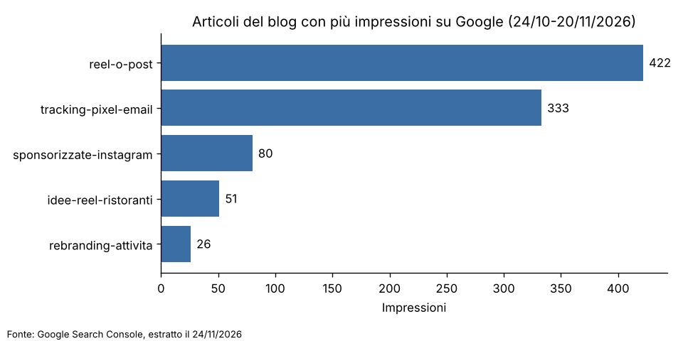
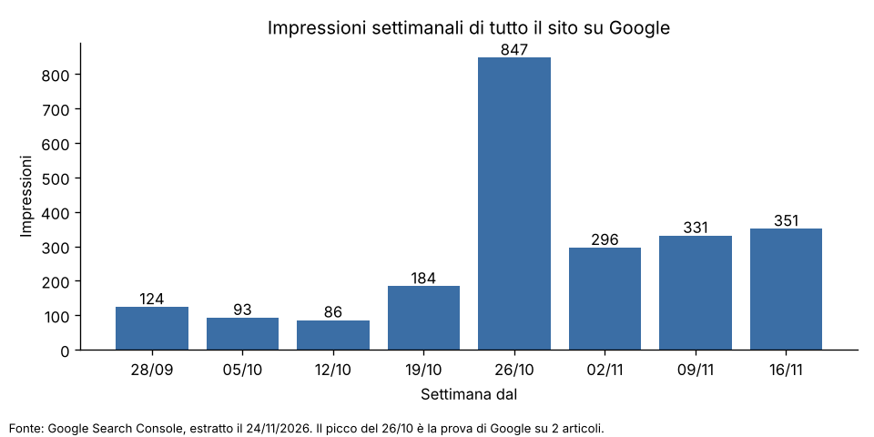

# Per il Blog: cosa funziona (primo giro, 24/11/2026)

**Fonti:**
- Google Search Console: dal 24/10 al 20/11, confrontato con il periodo dal 26/09 al 23/10;
- GA4: dal 24/10 al 23/11.
- Estratto il 24/11 con gli strumenti in `docs/seo/strumenti/`.

**Nota:** prima del 24/10 gli articoli del blog avevano 0 impressioni, quindi il confronto con le 4 settimane precedenti è "da 0".

## I 5 articoli che funzionano meglio
| # | Articolo | Impressioni | Clic | Posizione media |
|---|---|---|---|---|
| 1 | `reel-o-post-cosa-pubblicare-instagram` | 422 | 0 | 7,8 |
| 2 | `tracking-pixel-email-garante` | 333 | 5 | 7,2 |
| 3 | `sponsorizzate-instagram-attivita-locali` | 80 | 0 | 8,3 |
| 4 | `idee-reel-ristoranti` | 51 | 0 | 8,9 |
| 5 | `rebranding-attivita-commerciale` | 26 | 0 | 5,4 |

- **Prova di Google:** buona parte delle impressioni di 1 e 2 viene dalla prova del 26-30/10 (vedi linee guida §12), con un picco di 847 impressioni nella settimana del 26/10.
- **Da notare:** `instagram-su-google-seo-profilo` ha 2 clic su solo 16 impressioni (posizione 4,4). È un tema che la gente clicca.

## Le 5 query più promettenti (posizione 8-20)
Sono escluse le ricerche dei nomi dei clienti (Diram, Sublime, Paresteta…).

| # | Query (varianti sommate) | Pagina | Impressioni | Posizione | Cosa fare |
|---|---|---|---|---|---|
| 1 | "differenza tra reel e post" (+ "post o reel differenza", "post reel", "differenza tra real e post") | `/blog/reel-o-post-cosa-pubblicare-instagram` | 24 | 8,6-9,3 | Aggiornamento (§12 punto 6): risposta più netta nelle prime 2 righe, tabella di confronto, FAQ con queste varianti |
| 2 | "reel per ristoranti" (+ "reel ristorante", "idee per ristorante") | `/blog/idee-reel-ristoranti` | 19 | 10,5-17 | Aggiornamento: title più vicino a "reel per ristoranti", esempi di clienti ristoranti con link alle schede |
| 3 | "realizzazione siti web acquaviva delle fonti" | `/agenzia-comunicazione-acquaviva-delle-fonti` | 13 | 11,2 | Per il sito, non per il blog: la valuto nel lotto del 30/11 |
| 4 | "agenzia marketing / comunicazione polignano a mare" | `/agenzia-comunicazione-polignano-a-mare` | 13 | 9,9-12,8 | Per il sito: un articolo del blog con esempio dalla zona di Monopoli e Polignano che linki la pagina |
| 5 | "facebook ads a taranto" | `/meta-ads-taranto` | 4 | 16,5 | Link da `sponsorizzate-instagram-attivita-locali` a `/meta-ads-taranto` |

## Sessioni da AI (GA4, dal 24/10 al 23/11)
- 3 sessioni da chatgpt.com, atterrate su `/blog/idee-reel-ristoranti`, `/gestione-social-grottaglie` e `/video`.
- Gemini, Perplexity, Copilot e Claude: 0.

## Argomenti richiesti che non abbiamo
Non disponibile: nelle query delle ultime 4 settimane non ci sono richieste ripetute senza una pagina nostra. Lo ricontrollo il 30/11.

## Misura e obiettivo
| Richiesta | Prima (24/10-20/11) | Obiettivo | Ricontrollo |
|---|---|---|---|
| Aggiornare "reel o post" | 422 impressioni, 0 clic, posizione 7,8 | almeno 1 clic a settimana, posizione < 7 | 4 settimane dopo l'aggiornamento |
| Aggiornare "idee reel ristoranti" | 51 impressioni, posizione 8,9 | "reel per ristoranti" < posizione 10 | 4 settimane dopo l'aggiornamento |
